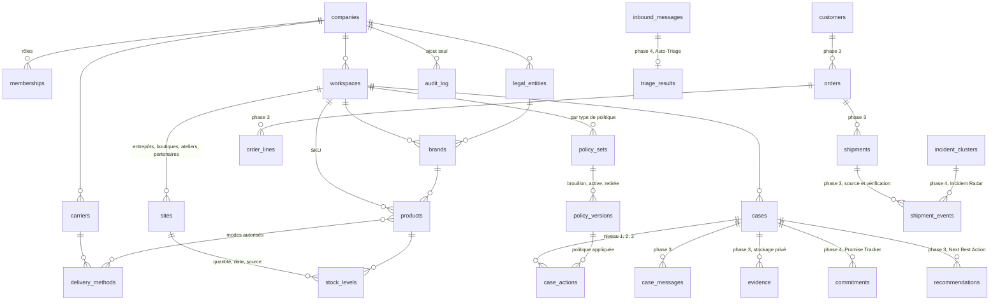

# PULS : audit et architecture cible

Configuration Engine, Rescue Mode, Operational Intelligence. Document de validation, 13 novembre 2026.

---

## 1. Architecture actuelle

```
Landing-page (dépôt)
├── racine, js/, supabase/   Arbor : autre produit (apprentissage), backend Supabase dédié. Hors périmètre PULS.
└── puls/
    ├── *.html, secteurs/    Site public, HTML statique généré par site-src/build.py
    ├── site.js, site.css    Interactions du site (menu, visite guidée, simulateur d'arbitrage, formulaire, connexion)
    ├── config.js            Point de collecte des demandes de démo (null : non branché)
    ├── app/                 PULS App : PWA, JavaScript sans framework
    │   ├── puls.js          1 092 lignes : données, règles, rendu et événements dans un seul fichier
    │   ├── effects.js       Identité visuelle (pouls, sceau, halo)
    │   ├── shell.js         Session, déconnexion, installation, service worker
    │   └── sw.js            Cache limité aux fichiers d'interface
    ├── db/                  NOUVEAU : migrations PostgreSQL et tests d'isolation
    └── site-src/            Générateur, captures, tests de bout en bout (Playwright)
```

Hébergement : GitHub Pages sert la branche principale du dépôt (`hmzr944.github.io/Landing-page/`). Le travail PULS est sur `claude/eager-clarke-db7g6z`, donc non publié tant qu'il n'est pas fusionné.

### Ce qui fonctionne réellement, ce qui est simulé, ce qui manque

| Élément | État | Détail |
|---|---|---|
| Site public, 13 pages | Réel | Testé (70+ contrôles), aucune donnée client |
| Formulaire de démonstration | Réel côté client | Aucun point de collecte branché, la confirmation le dit |
| File d'urgence, criticité, filtres, recherche | Réel sur données fictives | 7 dossiers codés dans `puls.js` |
| Gestes et règles (stock, zone, plafond) | Réel sur règles codées en dur | Voir problèmes P1 |
| Réponse au client | **Simulé** | Modèle de texte, pas une IA ; l'interface dit « proposé par l'assistant » |
| Proof Studio : observations | **Simulé** | Trois phrases fixes par catégorie, affichées comme « observations assistées » |
| Proof Studio : lien client | **Absent** | Le lien `puls.link/...` n'existe pas |
| Thermal Guard | Réel sur données fictives | Météo des hubs saisie à la main, aucune source |
| Carrier Autopsy | Réel sur données fictives | Intervalle de Wilson correct |
| Résolution d'un dossier | **Non persistant** | Perdu au rechargement, aucun journal |
| Authentification | **Absente** | Session de démonstration dans l'onglet ; la garde est côté navigateur uniquement |
| Multi-entreprise, configuration | **Absent** côté app | Fondations base de données livrées dans `db/` (section 5) |

## 2. À conserver

- L'identité : ivoire, crème, bordeaux, charbon ; Outfit et GT Walsheim ; le pouls, le sceau, les animations courtes.
- Les trois niveaux de vérité (fait vérifié, risque estimé, action recommandée) et leur codage par la forme.
- La criticité explicable par facteurs, le refus de conclure sous un seuil d'échantillon (Carrier Autopsy).
- Les garde-fous : relecture obligatoire, geste indisponible expliqué, validation au-delà du plafond.
- Les raccourcis existants (J, K, 1, 2, 3, R, /, G puis lettre).
- La structure du site public et son générateur, la PWA et sa politique de cache.

## 3. Problèmes identifiés

| # | Problème | Où | Gravité |
|---|---|---|---|
| P1 | Toutes les règles métier sont codées en dur : zones coursier, heure limite, plafond 150 €, pondérations du score, points d'émotion, bases thermiques, pourcentages de geste, nom de la conseillère | `app/puls.js` l. 10-14, 17-30, 224-239, 269, 316 | Bloquant pour le multi-entreprise |
| P2 | Règles dupliquées et **incohérentes** : l'app applique un plafond unique de 150 €, le site affiche 60 / 150 / 250 € par rôle | `app/puls.js` l. 13, `site.js` l. 65 | Élevée |
| P3 | Aucune persistance ni historique : une résolution disparaît au rechargement | `state.resolved` en mémoire | Bloquant |
| P4 | Deux fonctions présentées comme de l'IA sont des textes fixes (réponse, observations Proof Studio) | `draftReply`, `observations` | Élevée (honnêteté) |
| P5 | La criticité mélange risque produit, urgence commerciale et relation client en un seul total | `score()` | Moyenne : contraire au besoin de séparer les urgences |
| P6 | Horloge figée au 13 nov. 11:42 : la disponibilité du coursier ne suit pas l'heure réelle | `NOW` | Moyenne |
| P7 | Cycle de vie réduit à ouvert / résolu : ni attente, ni réouverture, ni promesse, ni historique d'échanges | `CASES` | Bloquant pour Rescue Mode |
| P8 | Un seul fichier de 1 092 lignes mêle données, règles, rendu et événements | `app/puls.js` | Moyenne : freine chaque évolution |
| P9 | Code mort : intro et rideau plein écran retirés mais encore présents | `effects.js`, `puls.css` | Faible |
| P10 | La garde d'accès de l'app est un script navigateur : acceptable pour des données fictives, inacceptable pour des données réelles | `app/index.html` | Bloquant avant tout pilote réel |
| P11 | La page Confidentialité contient « Responsable du traitement : à compléter » | `confidentialite.html` | À régler avant publication |
| P12 | Les raccourcis ne sont ni personnalisables ni contextuels ; les actions engageantes n'ont pas de dialogue de confirmation | `puls.js` | Moyenne |

## 4. Changements nécessaires

1. **Backend dédié** : un projet Supabase propre à PULS (PostgreSQL, Auth, Storage privé, fonctions Edge). Pas celui d'Arbor : clients, contrats et rayon d'incident différents.
2. **Couche de données dans l'app** : une interface unique `PulsStore` avec deux implémentations, `DemoStore` (fixtures fictives isolées dans un fichier et étiquetées) et `SupabaseStore`. Le rendu ne lit plus jamais une constante métier.
3. **Règles sorties du code** : chaque règle de P1 devient une politique versionnée lue depuis la base.
4. **Criticité à trois axes** : risque produit, urgence logistique, urgence commerciale, plus la relation client, chacun affiché séparément. La file se trie par une combinaison configurable, sans fusionner l'affichage.
5. **Exécution côté serveur** : les actions de niveau 3 passent par `request_action`, `decide_action`, `execute_action`. En démonstration, l'exécution est forcément simulée.
6. **Honnêteté de l'interface** : la réponse et les observations simulées sont étiquetées « modèle de texte » et « exemple simulé » jusqu'au branchement d'un vrai modèle côté serveur.
7. **Découpage de l'app** en modules : store, règles, file, dossier, actions, raccourcis, vues.

## 5. Modèle de données cible

Livré et testé dans cette étape : tout ce qui est marqué ✅ (`db/migrations/001_configuration_engine.sql`, 35 tests dans `db/test/`).



| Table | Rôle | État |
|---|---|---|
| `companies` | Locataire racine, environnement `demo` ou `production` | ✅ |
| `memberships` | Utilisateur, rôle (`admin`, `sav_manager`, `agent`, `logistics_manager`, `viewer`), statut | ✅ |
| `workspaces`, `legal_entities`, `brands` | Organisation de l'entreprise | ✅ |
| `sites` | Établissements ; `ships_orders` faux par défaut : une boutique n'est jamais un entrepôt implicite ; horaires, capacité, transfert, coursier : `NULL` si inconnu | ✅ |
| `products` | SKU, sensibilité et fragilité (`unknown` par défaut), températures et durée `NULL` si inconnues, restrictions, saisons, coût de revient `NULL` si inconnu | ✅ |
| `carriers`, `delivery_methods`, `product_delivery_methods` | Transporteurs et modes autorisés par produit | ✅ |
| `stock_levels` | Quantité, date et **source obligatoire** (`manual`, `csv`, `integration`) | ✅ |
| `policy_sets`, `policy_versions` | Politiques par type (incidents, criticité, résolution, autorisation, remboursement, remplacement, délais, escalade, ton) ; version active figée | ✅ |
| `cases` | Dossier, statut à 8 états, criticité et version de politique utilisée | ✅ (socle) |
| `case_actions` | Action proposée ou demandée, niveau, montant, statut, politique appliquée, demandeur, décideur, mode d'exécution | ✅ |
| `audit_log` | Journal en ajout seul, auteur obligatoire | ✅ |
| `product_margins` (vue) | Marge `NULL` tant que le coût de revient manque | ✅ |
| `customers`, `orders`, `order_lines`, `shipments`, `shipment_events` | Contexte du dossier ; chaque événement porte sa source et son statut de vérification | Phase 3 |
| `case_messages`, `evidence` | Historique des échanges, preuves (stockage privé, liens signés expirants, consentement, conservation) | Phase 3 |
| `recommendations` | Next Best Action, justification, statut `suggested` / `accepted` / `dismissed`, **distincte** de `case_actions` | Phase 3 |
| `inbound_messages`, `triage_results` | Message brut, références extraites, classification, confiance, doublon probable | Phase 4 |
| `incident_clusters` | Regroupement, éléments justificatifs, `cause_confirmed` faux par défaut | Phase 4 |
| `commitments` | Promesse, échéance, source, statut ; dépassements visibles | Phase 4 |
| Vues de performance | Calculées depuis les événements ; colonnes `estimated` et `realized` séparées | Phase 5 |

### Règles garanties par la base (testées)

| Garantie | Mécanisme |
|---|---|
| Une entreprise ne lit ni n'écrit les données d'une autre | RLS sur chaque table, appartenance déduite de `auth.uid()` |
| Impossible de relier une ligne à un parent d'une autre entreprise | Clés étrangères composites `(id, company_id)` |
| Seul l'admin configure ; le responsable logistique gère les stocks | Politiques RLS par rôle |
| Aucune action écrite directement depuis le navigateur | Écriture révoquée, fonctions `security definer` uniquement |
| Niveau 3 au-delà du plafond : validation par une autre personne habilitée | `request_action`, `decide_action` |
| Démonstration : aucune exécution réelle possible | `execute_action` force `simulated` ; en production, refus tant qu'aucun exécuteur n'est branché |
| Une politique active ne change plus ; les décisions passées gardent leur version | Déclencheur de gel, index « une seule active », référence de version sur chaque action |
| Journal en ajout seul, lisible par admin et responsable SAV | Déclencheur, RLS |

## 6. Plan de développement priorisé

Chaque phase livre un état utilisable, testé, sans rien retirer de l'existant.

### Phase 2 : Configuration Engine (prochaine)
1. Créer le projet Supabase PULS, appliquer `001`, brancher l'authentification par e-mail (comptes nominatifs, invitations, rôles).
2. Introduire `PulsStore` dans l'app ; déplacer les 7 dossiers fictifs dans une fixture étiquetée ; faire lire toutes les règles de P1 depuis les politiques.
3. Module **Configuration** (aujourd'hui « Bientôt ») : entreprise, workspaces, entités, marques, établissements, catalogue, transporteurs, stocks, politiques avec brouillon, comparaison et activation, utilisateurs et rôles.
4. Import CSV contrôlé du catalogue et des stocks (aperçu, validation, rapport d'erreurs).
5. Tests : isolation (étendus), parcours de configuration, versionnement de bout en bout.

### Phase 3 : Rescue Mode
1. Disposition à trois zones : file, dossier, actions ; dense et sans cartes décoratives.
2. File triée par politique de criticité configurable, axes séparés, facteurs visibles, risque de réouverture et contacts précédents.
3. Dossier intelligent : client, commande, produits, échanges, livraison, preuves, historique, promesses ; faits, estimations et **informations manquantes** distingués.
4. Next Best Action justifiée, jamais confondue avec une action exécutée.
5. Réponses par un modèle côté serveur, au ton de la marque, sur les seules informations disponibles ; relecture et validation obligatoires.
6. Zero Mouse : registre de raccourcis contextuels, personnalisables, affichés ; confirmation pour toute action de niveau 3.
7. Proof Studio client : lien signé expirant, téléversement privé, consentement.

### Phase 4 : Intelligence Layer
Auto-Triage (extraction, rattachement, doublons, informations manquantes) sur les messages importés ou saisis ; Incident Radar avec éléments justificatifs et sans cause affirmée ; Promise Tracker. Connecteurs réels uniquement quand ils existent.

### Phase 5 : Performance
Indicateurs calculés depuis l'historique : entrées, traités, en attente, première réponse, résolution, réouverture, retards, automatisation, coûts ; économies **estimées** séparées des économies **réalisées** ; indemnisations récupérées seulement si confirmées.

## 7. Décisions validées

| Décision | Choix |
|---|---|
| Backend | Projet Supabase dédié à PULS : `wqqxthpcqczmwigokhus` |
| Technologie | TypeScript progressif, sans réécriture ; premier module : Configuration Engine |
| IA | OpenAI, exclusivement côté serveur, derrière une abstraction de fournisseurs |
| Identité légale | Rien d'inventé : état « Informations légales à compléter » jusqu'à fourniture ; mise en production bloquée sans elle |

### Vérification de compatibilité (faite avant toute modification)

| Contrainte existante | Conséquence | Solution retenue |
|---|---|---|
| App en scripts classiques (variables globales), sans bundler | Un module TypeScript ne peut pas être importé par `puls.js` | `tsc` compile `app/src` en modules ES natifs dans `app/dist` ; ils s'enregistrent dans l'espace de noms partagé `window.PULS`. `shell.js` attend l'événement `puls:config-ready` avant de démarrer |
| GitHub Pages ne compile rien | La sortie TypeScript doit exister dans le dépôt | `app/dist` est versionné ; `npm run check:dist` (CI) échoue si elle n'est pas à jour |
| supabase-js chargé par CDN (UMD) | Pas d'import d'exécution côté TypeScript | `import type` uniquement (paquet officiel en dépendance de développement, version identique au CDN : 2.45.4) |
| Fonctions serveur Supabase en Deno, Deno absent du poste et de la CI | Tests impossibles en Deno ici | Logique écrite sans dépendance à Deno (`handler.ts`, `_shared/ai`), testée sous Node 22 (types retirés à l'exécution) ; seul `index.ts` dépend de Deno |
| Node retire les types sans les compiler | Interdit certaines syntaxes TypeScript (propriétés de paramètres, énumérations) | Champs explicites dans les classes ; vérifié par les tests |
| Ajout de `"type": "module"` dans `puls/package.json` | Les scripts Playwright en CommonJS cassaient | Renommés en `.cjs` |
| Session en `sessionStorage` (règle déjà en place) | supabase-js utilise `localStorage` par défaut | Stockage de session imposé à `sessionStorage`, clé `puls-auth` |
| Arbor utilise déjà le même dépôt et un autre projet Supabase | Risque de mélange | Migrations PULS dans `puls/db`, fonctions dans `puls/supabase`, projet distinct |

### Architecture IA

```
Navigateur (conseiller) ── POST /functions/v1/ai { task, company_id, input } + jeton de session
        │
        ▼
Fonction « ai » (Deno, Supabase)
  index.ts      : branchement (Supabase, secrets, CORS)
  handler.ts    : jeton vérifié, rôle lu avec les droits de l'utilisateur (RLS), entrées validées et minimisées,
                  quota mensuel par entreprise, journal sans contenu (ai_calls)
  _shared/ai/
    provider.ts : interface AIProvider (sortie structurée JSON Schema), erreurs typées
    openai.ts   : implémentation OpenAI (Chat Completions, json_schema strict)
    registry.ts : choix par AI_PROVIDER ; ajouter Anthropic = un fichier + une ligne
    tasks.ts    : tri (niveau 1) et rédaction (niveau 2) : consignes, schémas, contrôles après génération
```

Garde-fous vérifiés par les tests : références et e-mails absents du message écartés ; montants non autorisés, affirmations sanitaires et phrase de prudence manquante signalés ; brouillon jamais envoyé (`sent: false`, `requires_review: true`) ; clé et détail des erreurs du fournisseur jamais renvoyés ; aucun contenu dans le journal.

La fonction est écrite et testée mais **pas encore déployée** ni branchée dans l'interface : il faut la clé OpenAI et le modèle (secrets Supabase), puis l'intégration dans Rescue Mode (phase 3).

## 8. État d'avancement de la phase 2

| Élément | État |
|---|---|
| Migrations 001 à 003 | Écrites, 60 tests sur PostgreSQL 16 ; **à appliquer** sur le projet Supabase (`db/README.md`) |
| Comptes (inscription, connexion, mot de passe oublié) | Branchés sur Supabase Auth ; connexion réelle testée (refus d'identifiants inconnus) |
| Règles sorties du code (P1, P2) | Délégation, coursier, gestes, criticité, ton lus depuis les politiques ; site et app alignés (60 / 150 / 250 / 1 000 €) |
| Horloge réelle (P6), libellés honnêtes (P4), code mort (P9) | Faits |
| Module Configuration (TypeScript) | Organisation, établissements, catalogue, transporteurs, stocks, politiques versionnées, équipe, journal |
| Restant de P1 | Modèle d'indice thermique (pondérations) encore dans le code : à transformer en politique avec Thermal Guard (phase 3) |
| Import CSV | Non commencé |

## Commandes

```bash
puls/db/test/run.sh    # base jetable, migrations, 35 tests d'isolation et de permissions
```
